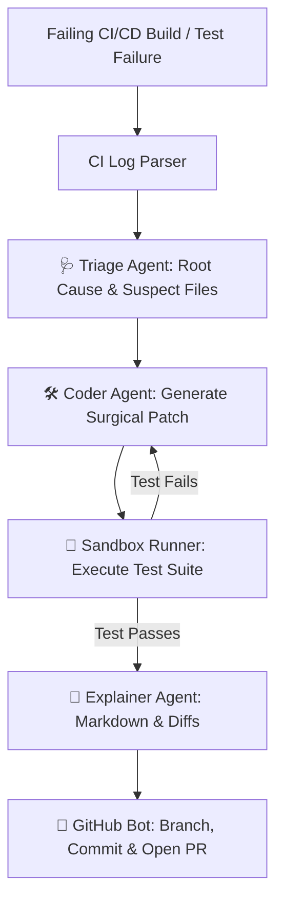

# 🩺 GitHealer

<p align="center">
  
  
  
  
  
</p>

```
   ____ _ _   _   _            _             
  / ___(_) |_| | | | ___  __ _| | ___ _ __   
 | |  _| | __| |_| |/ _ \/ _` | |/ _ \ '__|  
 | |_| | | |_|  _  |  __/ (_| | |  __/ |     
  \____|_|\__|_| |_|\___|\__,_|_|\___|_|     
```

> **GitHealer** is an autonomous multi-agent AI system that detects failing CI/CD builds, reproduces the errors in an isolated sandbox, generates surgical zero-regression patches, and automatically opens verified Pull Requests.

---

## ⚡ Why GitHealer?

When a CI pipeline turns red at 2:00 AM, developers usually spend hours reading verbose terminal logs, pinpointing faulty commits, and applying quick fixes. 

**GitHealer turns CI failures into green builds autonomously:**
- 🔍 **Diagnostic Triage Agent**: Ingests raw CI failure logs and pinpoints root causes, stack traces, and suspect files.
- 🔬 **Surgical Coder Agent**: Synthesizes minimal, style-preserving code patches targeting the exact bug.
- 🧪 **Sandboxed Test Runner**: Re-executes the test suite in an isolated environment to verify that the fix works and creates no regressions.
- 🤖 **Automated PR Bot**: Creates a git branch, commits the verified patch, and opens a Pull Request with an interactive engineering explanation and call graph.
- 🚀 **Zero External Dependencies Required for Demo**: Ships with an intelligent heuristic fallback so you can try it immediately offline without an API key!

---

## 🏗️ Multi-Agent Architecture



---

## 🚀 Dual-Engine Superpowers

GitHealer is equipped with two complementary engines:

### 🏥 Engine 1: Git Repository Emergency Room & Disaster Recovery
Diagnose local repository health, recover lost commits from reflog, unstick broken rebases, and detect leaked API keys:

```bash
# 🔍 Instant repository health scan (detached HEAD, stale branches, uncommitted bloat)
git-healer check

# 🩹 Interactive emergency room wizard (recover lost reset commits, rebase rescue, squash)
git-healer fix

# 🔐 Secret leak scanner (scans for OpenAI, Gemini, AWS, GitHub tokens & .env files)
git-healer secrets

# 🧹 Clean up merged local branches
git-healer cleanup
```

---

### 🤖 Engine 2: Autonomous Multi-Agent CI/CD Self-Healing
Diagnoses test failures in an isolated sandbox, generates surgical code patches, and opens verified Pull Requests:

```bash
# Try the instant interactive demo
git-healer demo

# Self-heal any project
git-healer run --repo ./my-project --cmd "pytest"
```

Want to see GitHealer heal a broken repository right inside your terminal? Run:

```bash
git-healer demo
```

GitHealer will automatically spin up a test project with an intentional bug, diagnose the failure, generate the unified diff, and pass all verification tests!

### 3. Run GitHealer on Any Repository

To heal a local repository:

```bash
# Autodetects test command (pytest, npm test, cargo test, go test)
git-healer run --repo ./path/to/my-project

# Or specify a custom test command:
git-healer run --repo ./path/to/my-project --cmd "pytest tests/test_api.py"

# Or analyze a saved GitHub Actions failure log:
git-healer run --repo ./path/to/my-project --log ci_failure.log
```

---

## 🌟 Superb New Features

### 1. 🖥️ Interactive Web Dashboard
Launch a sleek local UI to monitor real-time healing progress, explore interactive code diffs, and review sandbox verification logs:
```bash
git-healer dashboard --port 8080
```

### 2. 🩺 Environment Doctor & Missing Dependency Diagnoser
Automatically scan for missing dependencies (`ModuleNotFoundError`, missing npm packages) and get suggested remediation commands:
```bash
git-healer doctor --repo . --log ci_failure.log
```

### 3. 🔬 AI Flaky Test Detection & Stability Scoring
Run automated repeated trials in the sandbox to distinguish intermittent race-condition flakes from deterministic bugs:
```bash
git-healer check-flaky --cmd "pytest tests/" --runs 5
```

### 4. 🛡️ Safety Checkpoints & Instant Rollback
GitHealer creates automatic pre-heal snapshots. If you ever want to revert a patch, restore your repository to pristine condition with one command:
```bash
git-healer rollback
```

### 5. ✍️ Commit Doctor & Conventional Commit Linter
Verify commit messages against the Conventional Commits specification and detect vague messages:
```bash
git-healer commit-lint
# Or lint a specific message:
git-healer commit-lint -m "feat(api): add health check endpoint"
```

### 6. 📊 Repository Health Scorecard (0–100) & Badge Generator
Compute an automated health audit (Git hygiene, test coverage, secrets, commit quality) and get an SVG/Markdown badge:
```bash
git-healer score
```

### 7. 🛡️ Smart .gitignore Generator & Security Auditor
Auto-detect repository languages and frameworks to generate clean rules or audit existing exclusions:
```bash
# Audit existing .gitignore for missing critical security rules:
git-healer gitignore --audit

# Automatically append missing security rules:
git-healer gitignore --apply
```

### 8. 📦 Automated Semantic Release & Changelog Generator
Parse Conventional Commits, compute next SemVer release (Major/Minor/Patch), and generate categorized release notes:
```bash
git-healer changelog --version 1.0.0 --write
```

### 9. 🪝 Automated Pre-Commit & Commit-Msg Security Hooks
Install automatic Git hooks that block leaked `.env` keys, private credentials, and invalid commit messages before they ever touch your Git history:
```bash
# Install hooks in your repo:
git-healer hook install

# Check hook status:
git-healer hook status
```

---

## 🤖 Use as a GitHub Action in Your Repositories

Add GitHealer to your existing repository workflow so it fixes test failures automatically:

Create `.github/workflows/githealer.yml`:

```yaml
name: GitHealer Auto-Heal
on:
  workflow_run:
    workflows: ["CI", "Test Suite"]
    types: [completed]

jobs:
  heal:
    runs-on: ubuntu-latest
    if: ${{ github.event.workflow_run.conclusion == 'failure' }}
    permissions:
      contents: write
      pull-requests: write

    steps:
      - uses: actions/checkout@v4
      
      - name: Run GitHealer Action
        uses: <your-username>/git-healer@v1
        with:
          gemini_api_key: ${{ secrets.GEMINI_API_KEY }}
          github_token: ${{ secrets.GITHUB_TOKEN }}
          auto_pr: "true"
```

---

## ⚙️ Configuration (`.githealer.yaml`)

You can customize GitHealer by placing a `.githealer.yaml` file in your repository:

```yaml
# LLM Model Selection (e.g., gemini-2.5-flash, gemini-3.8-flash)
model: "gemini-2.5-flash"

# Custom test command to verify fixes in sandbox
test_command: "pytest"

# Maximum refinement iterations before giving up
max_retries: 3

# Timeout for sandbox execution (seconds)
sandbox_timeout: 60

# Automatically open Pull Request on verified fix
auto_create_pr: true
```

---

## 🧩 Supported Test Frameworks

| Language / Framework | Log Signature Detection | Sandbox Runner |
| :--- | :--- | :--- |
| **Python** (`pytest`, `unittest`) | ✅ Stack traces, summary info, tracebacks | ✅ Native |
| **Node.js / TypeScript** (`Jest`, `Vitest`) | ✅ `FAIL src/..`, assertion diffs | ✅ Native |
| **Go** (`go test`) | ✅ `--- FAIL: TestFoo` | ✅ Native |
| **Rust** (`cargo test`) | ✅ Panic threads, assertion failures | ✅ Native |

---

## 🧪 Running Unit Tests

```bash
pytest tests/ -v
```

All 8 tests test log parsing, AST syntax verification, unified diff patching, and end-to-end self-healing.

---

## 🤝 Contributing

Contributions, issues, and feature requests are welcome!  
See [CONTRIBUTING.md](CONTRIBUTING.md) to get started.

---

## 📄 License

Distributed under the **MIT License**. See [LICENSE](LICENSE) for more information.
